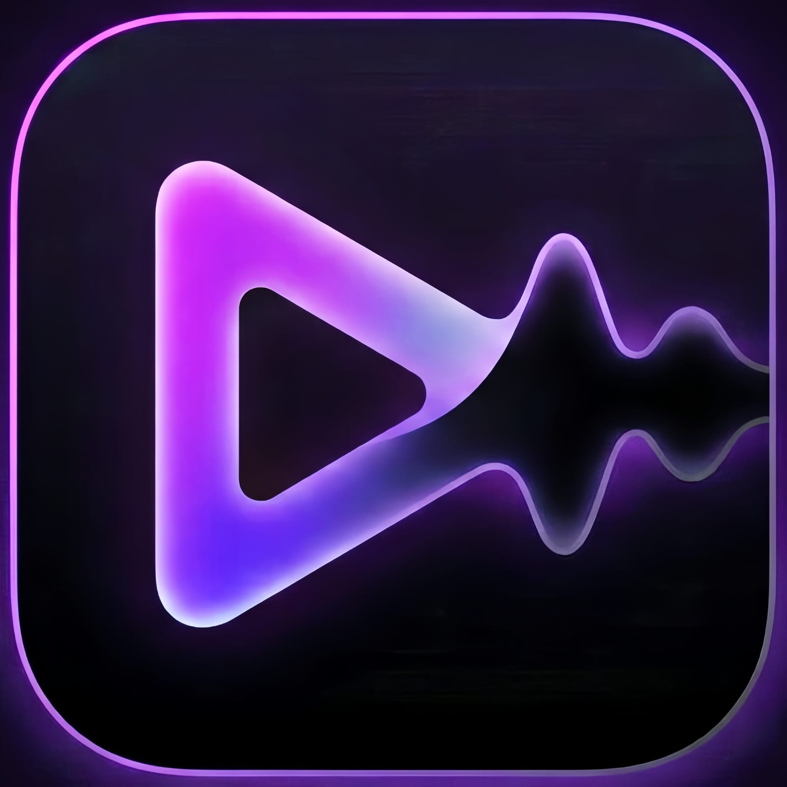

<p align="center">
  
</p>

<h1 align="center">🎵 BeatNova</h1>

<p align="center">
  <strong>Akıllı Müzik Çalar & Yapay Zeka Destekli Müzik Asistanı</strong>
</p>

<p align="center">
  
  
  
  
  
</p>

---

## 📖 Proje Hakkında

**BeatNova**, cihazınızdaki müzik dosyalarını otomatik olarak tarayan, güçlü bir arka plan oynatıcısıyla dinlemenizi sağlayan ve yapay zeka destekli müzik asistanıyla yeni şarkılar keşfetmenize yardımcı olan modern bir Android müzik çalar uygulamasıdır.


---

## ✨ Öne Çıkan Özellikler

### 🎶 Müzik Çalar
- 📂 Cihazınızdaki tüm müzik dosyalarını otomatik tarama (`expo-media-library`)
- ▶️ Arka planda kesintisiz müzik çalma (`react-native-track-player v5`)
- 🔀 Karıştırma, tekrarlama ve sıra yönetimi
- 🎨 Otomatik kapak resmi çekme (YouTube thumbnail & iTunes/Deezer API)
- 📊 İlerleme çubuğu ile şarkı kontrolü

### 🤖 Yapay Zeka Müzik Asistanı
- 💬 Google Gemini AI ile kişiselleştirilmiş müzik önerileri
- 🔍 Web araması entegrasyonu ile güncel müzik trendleri (Tavily API)
- ⚡ Hızlı erişim butonları — "Enerjik playlist", "Odaklanma müziği", "Popüler trendler"
- 📋 Detaylı playlist bilgileri (enerji seviyesi, ruh hali, süre, tür)

### 🎨 Temalar & Kişiselleştirme
- 🌙 Karanlık / Aydınlık mod desteği
- 🎭 Birden fazla renk paleti (Neon, Pastel, Gün Batımı ve daha fazlası)
- 📐 Özelleştirilebilir yazı tipi boyutu

### 📊 İstatistikler & Takip
- ⏱️ Toplam dinleme süresi
- 🏆 En çok dinlenen şarkılar
- 📈 Dinleme alışkanlıkları grafiği

### ❤️ Favoriler & Playlistler
- 💾 Favori şarkılarınızı kaydedin
- 📋 Kendi playlistlerinizi oluşturun
- 📱 Veriler cihazda güvenle saklanır

### 🔔 Zil Sesi Kesme & Ayarlama (Sadece Android)
- ✂️ Şarkıdan 3 ila 30 saniye arası bölüm seçme (`react-native-video-trim`)
- 🎚️ Çift tutamaklı Reanimated + Gesture Handler aralık seçici ve dalga formu
- 🔁 Seçilen aralığı canlı döngüsel (loop) önizleme
- 📁 MediaStore `DIRECTORY_RINGTONES` entegrasyonu (mükerrer kayıt temizleme korumalı)
- ⚙️ Sistem ayarı değiştirme izni (`WRITE_SETTINGS`) kontrolü ve yönlendirmesi
- 🔔 Tek dokunuşla varsayılan Android zil sesi yapma (`RingtoneManager`)
- ⚠️ *Not: Bu özellik yerel Android MediaStore ve RingtoneManager kullandığı için Expo Go üzerinde çalışmaz; Development Build (`npx expo run:android`) gerektirir.*

### 🎛️ Donanımsal Ekolayzır & Ses Stüdyosu (Sadece Android)
- 🎚️ 5-Bant Donanımsal Grafik Ekolayzır (60 Hz, 230 Hz, 910 Hz, 3.6 kHz, 14 kHz; -12 dB ila +12 dB)
- 🔊 Yerel Android Ses Efekti motoru (`android.media.audiofx.Equalizer`)
- 💥 Bas Güçlendirici (0% - 100% `android.media.audiofx.BassBoost`)
- 🌐 3D Çevreleyen Ses Sanallaştırıcı (0% - 100% `android.media.audiofx.Virtualizer`)
- 🎵 8 Farklı Hazır Müzik Profili (Flat, Bass Boost, Vocal, Rock, Pop, Jazz, Electronic, Classical)
- ⚡ 0ms anlık ses filtresi güncellemesi ve otomatik ses oturumu takibi (`AudioSession` listener)
- ⚠️ *Not: Donanımsal DSP filtreleri yerel Android ses katmanına bağlı olduğu için Expo Go üzerinde çalışmaz; Development Build (`npx expo run:android`) gerektirir.*

---

## 🏗️ Teknoloji Yığını

| Katman | Teknoloji |
|---|---|
| **Framework** | [Expo](https://expo.dev) (SDK 54) + React Native 0.81 |
| **Dil** | TypeScript |
| **Navigasyon** | Expo Router v6 (Drawer + Tabs + Stack) |
| **Stil** | NativeWind v4 (TailwindCSS) |
| **Müzik Çalar** | React Native Track Player v5 (`@rntp/player`) |
| **Yapay Zeka** | Google Gemini 2.5 Flash (AI SDK) |
| **Web Araması** | Tavily API |
| **Medya Erişimi** | Expo Media Library |
| **Durum Yönetimi** | React Context + TanStack Query |
| **Ağ Kontrolü** | @react-native-community/netinfo |
| **Reklamlar** | Google Mobile Ads (AdMob) |
| **Animasyonlar** | React Native Reanimated |
| **Build & Deploy** | EAS Build + EAS Submit |

---

## 📁 Proje Yapısı

```
BeatNova/
├── app/                          # Expo Router sayfaları
│   ├── (auth)/                   # Giriş / Kayıt ekranları
│   ├── (drawer)/                 # Drawer menüsü
│   │   ├── (tabs)/               # Alt sekme navigasyonu
│   │   │   ├── index.tsx         # 🏠 Ana Sayfa
│   │   │   ├── songs.tsx         # 🎵 Şarkı Listesi
│   │   │   ├── MusicAssistant.tsx # 🤖 AI Müzik Asistanı
│   │   │   ├── PlayList.tsx      # 📋 Playlistler
│   │   │   └── settings.tsx      # ⚙️ Ayarlar
│   │   ├── Favorite.tsx          # ❤️ Favoriler
│   │   ├── Statistic.tsx         # 📊 İstatistikler
│   │   └── Theme.tsx             # 🎨 Tema Seçimi
│   └── api/
│       └── object+api.ts         # 🧠 AI Backend (Gemini API)
├── components/
│   ├── AudioPlayer.tsx           # 🎧 Mini Oynatıcı Bileşeni
│   ├── ProgressSection.tsx       # 📊 İlerleme Çubuğu
│   └── songs/
│       └── songsService.tsx      # 🔧 Şarkı Yükleme & Kapak Resmi Servisi
├── hooks/
│   └── useAudioPlayer.ts         # 🎵 Müzik Çalar Hook'u
├── providers/
│   └── player-context.tsx        # 🔄 Global Çalar Durumu
├── services/
│   ├── playbackService.ts        # ▶️ Arka Plan Oynatma Servisi
│   ├── PlaylistServices.ts       # 📋 Playlist Yönetimi
│   └── StatisticServices.ts      # 📈 İstatistik Servisi
├── lib/
│   └── tools/
│       └── webSearch.ts          # 🔍 Tavily Web Araması
├── theme/                        # 🎨 Tema & Renk Paletleri
├── schemes/                      # 📐 Zod Şemaları
└── assets/                       # 🖼️ Görseller & Fontlar
```

---


## 🚀 Geliştirme & Build Alma
 
Bu projede özel yerel modüller (`ringtone-setter`, `react-native-video-trim`) bulunduğu için standart Expo Go uygulaması yerine **Expo Development Build** kullanılmalıdır.
 
```bash
# Yerel Android Cihaz/Emülatör için Development Build:
npx expo run:android

# EAS Build ile Cloud üzerinde Development Build:
eas build --profile development --platform android
```

---

## 📱 Ekran Görüntüleri

> *Yakında eklenecek*

---


## 📄 Lisans

Bu proje özel (proprietary) bir yazılımdır. Tüm hakları saklıdır.

Kaynak kodun kopyalanması, değiştirilmesi, dağıtılması veya ticari kullanımı
yazarın (Hatayazılım) yazılı izni olmadan yasaktır.

© 2025-2026 Hatayazılım. Tüm hakları saklıdır.

---

## 👨‍💻 Geliştirici

**Hatayazılım** — [@Hatayazilim](https://hatayyazilim.com/)

---

<p align="center">
  BeatNova ile müziğin tadını çıkarın 🎧✨
</p>
